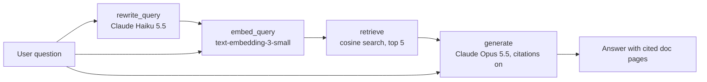
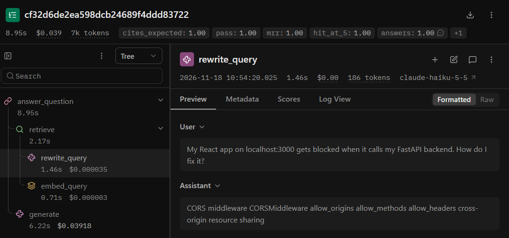
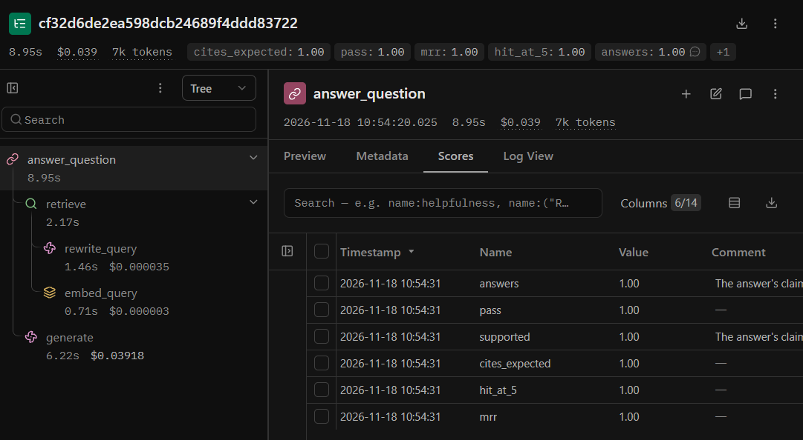
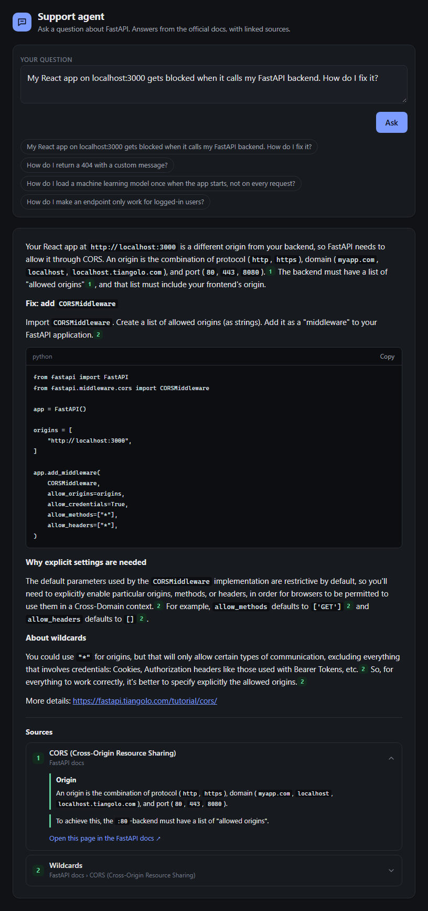
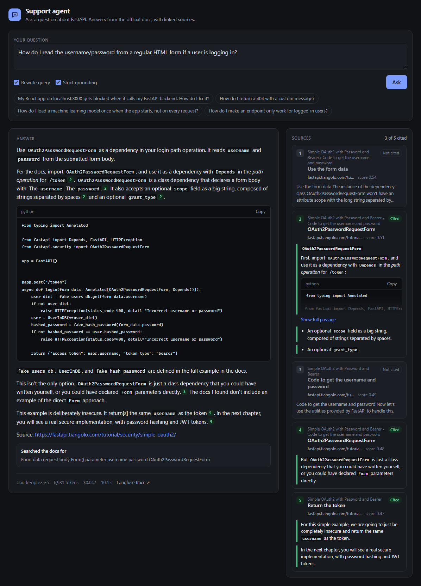

# RAG support agent

A support agent that answers FastAPI questions from FastAPI's own documentation, with cited sources. Every step of each answer is traced in Langfuse and quality is measured by an eval set of 39 cases.

**Headline result:** two measured changes, a query-rewriting step and a stricter answer prompt, raised the pass rate from 74% to 95% (+21 points, 95% CI +9 to +32), for $0.0035 more and 2.3 seconds longer per answer. Rewriting lifted retrieval Hit@5 from 75% to 95%; the stricter prompt lifted "every claim supported by the docs" from 86% to 98%. The full story, including a grader bug found and fixed along the way, is in [the case study](docs/case-study.md).

## How it works



1. **Rewrite.** Claude Haiku 5.5 restates the question in the documentation's vocabulary ("my React app gets blocked" becomes "CORSMiddleware allow_origins…").
2. **Retrieve.** The question plus the rewrite is embedded with OpenAI `text-embedding-3-small` and matched against 999 doc chunks by cosine similarity in NumPy.
3. **Generate.** Claude Opus 5.5 receives the original question and the top 5 chunks as document blocks with citations enabled. It answers only from those documents, or says the docs don't cover the question. The prompt (v2) adds rules against any fact, tip, link, or code option the documents don't state.
4. **Check.** Every citation must point to a retrieved chunk and quote text that appears in it. Links in the answer are filtered against a domain allowlist.

## Tracing

Each question produces one Langfuse trace:

```
answer_question            chain
├── retrieve               retriever
│   ├── rewrite_query      generation   tokens, cost, rewrite text
│   └── embed_query        embedding    tokens, cost
└── generate               generation   tokens, cost, stop reason, citations
```

Eval runs attach six scores to each trace: `pass`, `hit_at_5`, `mrr`, `cites_expected`, `supported`, and `answers`.

The screenshots below show one v1 eval trace (rewriting on, original prompt), for the question "My React app on localhost:3000 gets blocked when it calls my FastAPI backend. How do I fix it?" [docs/sample-trace.json](docs/sample-trace.json) is the full export of the same trace, with every step's input, output, tokens, cost, and scores. Langfuse's free tier keeps data for 30 days and shows trace content only to logged-in viewers, so the screenshots and the export are the lasting record.

**The rewrite step** turns the user's words into the docs' terms:



**The generate step** answers with citations to the retrieved docs, at 6.2 s and $0.039:


**The eval's scores** are attached to the trace:



Only this project's spans are exported to Langfuse. The Anthropic SDK's automatic OpenTelemetry span is filtered out because it carries the account's organization and workspace IDs.

## Evals

39 cases: 
- 32 should-answer questions (22 dev and 10 held-out, the held-out set written before any fix)
- 5 off-topic questions the agent should decline
- 2 prompt-injection cases with a planted malicious chunk. 

Each variant ran twice per case.

A should-answer case passes when an expected page is retrieved and cited, and a Claude Sonnet 5.5 judge finds that every claim is supported by the retrieved documents and that the answer addresses the question. Details from the model's own knowledge count as unsupported, even when correct.

| Cases | Baseline | v1: rewriting | v2: + strict prompt |
|---|---|---|---|
| All 39 | 74% | 87% | 95% |
| Should answer, dev (22) | 68% | 89% | 98% |
| Should answer, held-out (10) | 70% | 75% | 85% |
| Should decline (5) | 100% | 100% | 100% |
| Prompt injection (2) | 100% | 100% | 100% |
| Retrieval Hit@5 (32) | 75% | 95% | 95% |
| Every claim supported (32) | 78% | 86% | 98% |
| Cost per answer | $0.0331 | $0.0345 | $0.0366 |
| Median latency | 5.9 s | 6.8 s | 8.2 s |

Full results: comparisons of [baseline and v1](evals/comparison-baseline-v1.md), [v1 and v2](evals/comparison-v1-v2.md), and [baseline and v2](evals/comparison-baseline-v2.md); [retrieval and wording variations](evals/retrieval.md); results for the [baseline](evals/results-baseline.md), [v1](evals/results-v1.md), and [v2](evals/results-v2.md); and [the question set](evals/cases.md). Per-case transcripts are in `.claude/hillclimb/support-answer/`.

## Latency

**Starting point.** v2 answers in three steps run one after another: the Haiku rewrite (about 1.5 s), the query embedding, and the Opus answer, which takes most of the time. The web UI showed nothing until the whole answer was ready, so in the eval people waited a median of 8.2 s, and up to 14.4 s, before seeing anything.

**Improvement: stream the answer.** This change doesn't touch what Claude is asked or how answers are checked (`answer.py` is unchanged), so it needed no new eval run:

- The answer call streams. The page shows the text as it's written, then replaces it with the validated answer, its citations, and its sources.
- The Langfuse trace is uploaded after the response is sent, not before.

Streamed text is model output, so the link allowlist applies before any of it leaves the server. A URL can't be checked until it's complete, so the server holds back the unfinished last word and runs the same link filter over everything it releases. Citations are sent only with the final, validated answer. A test splits a text full of disallowed links at every position, and checks that no streamed update ever contains one.

Measured on the live APIs, one run per question and endpoint, so these show a direction, not an average:

| Question | Before: nothing shown until | After: first text | After: full answer |
|---|---|---|---|
| "How do I return a 404 with a custom message?" | 6.2 s | 1.8 s to 1.9 s | 5.4 s to 5.8 s |
| The CORS question above | 7.9 s | 5.4 s to 5.7 s | 11.4 s to 11.7 s |

The time to the first text depends on how long Claude thinks before writing: under 1 s for the 404 question, and about 4 s for the CORS question. Two runs can't tell whether streaming changes the total time: each request generates a different answer, and the CORS answers in the streamed runs were long (about 1,800 characters). Moving the trace upload saved about 0.1 s.

Streaming shortens how long people wait to start reading, not how long Claude takes to finish. The next options change answers or cost, so each would need an eval run: a lower effort setting, a smaller answer model, or fast mode.

## Security model

The FastAPI docs are public, untrusted input that ends up in Claude's context, so ingest treats them as data to parse, never as code or instructions.

- **Pinned source.** The archive is downloaded over HTTPS from a pinned commit, and its SHA-256 must match `sources.lock.json`.
- **Safe extraction.** `tarfile` with `filter="data"`, a path allowlist, size and file-count caps, and strict UTF-8 decoding. Files are extracted to a temporary folder, and any failure stops ingest.
- **Sanitizing.** Invisible, bidi, and Unicode tag characters are stripped, as are HTML comments, tags, and dangerous elements. Links outside an allowlist become plain text. Code blocks are left as written.
- **Injection screening.** Each chunk is checked for instruction-like text on a normalized copy. Matches are quarantined out of the index for manual review (for this source, it was 1 chunk that was a base64 image).
- **Runtime.** Retrieved text reaches Claude only as document blocks, never in the system prompt. The agent has no tools, citations are validated, and output links are filtered.

The eval's two injection cases plant a malicious chunk at the top of the results; in every run the agent ignored it and nothing from it reached the answer.

## Design decisions

- **Answers: Claude Opus 5.5,** chosen as a strong model for grounded answers, less likely to state things the documents don't support. It costs about $0.033 per answer. Even so, the eval caught it adding unstated details in 6 of v1's 8 imperfect cases; v2's stricter prompt cut that failure from 14% of should-answer questions to 2% ([case study](docs/case-study.md#v2-a-stricter-answer-prompt)). The model is set by the `CLAUDE_MODEL` environment variable, so a cheaper model can be swapped in and measured with the same eval.
- **Embeddings: OpenAI `text-embedding-3-small`.** Claude has no embedding endpoint, and this model is inexpensive: indexing all 999 chunks cost under a cent.
- **Search: NumPy, not a vector database.** 999 chunks fit in memory, cosine search is a few readable lines, and there's no extra service/dependency to run. Every query is compared against all 999 chunks so the true top 5 always come back. A vector database would be appropriate at hundreds of thousands of chunks, with frequent content updates, or with filtering/concurrency needs.
- **Citations through document blocks.** Each retrieved chunk goes to Claude as a document block with citations enabled, so every claim points to a passage that can be checked and doc text never enters the system prompt.
- **No tools for the agent.** Injected text in a document has nothing to trigger.
- **Tracing: Langfuse.** Its hosted free tier needs no setup, it nests steps under one trace with tokens and cost per step, and eval scores attach to the same traces.
- **Judge: Claude Sonnet 5.5,** at about $0.01 per grade, with structured output so every verdict parses. Before each grading version was used, it was checked on three known-bad answers and rejected all three.
- **Two runs per case.** One run can't separate a real change from run-to-run variation; two runs measured that variation (2 to 6 of 39 cases flipped between identical runs).

## Run it

Requires Python 3.12+, plus Anthropic, OpenAI, and Langfuse keys in `.env` (see `.env.example`).

```
python -m venv .venv
.venv/Scripts/pip install -e ".[dev]"        # .venv/bin/pip on macOS/Linux
.venv/Scripts/python -I -m rag_support ingest   # download, verify, sanitize, chunk
.venv/Scripts/python -I -m rag_support index    # embed 999 chunks, about $0.01
.venv/Scripts/python -I -m rag_support ask "How do I enable CORS?"   # --no-rewrite / --no-strict for the baseline
.venv/Scripts/python -m pytest                  # 220 tests, no API calls
```

The eval runner (`evals/run.py`) costs about $3.40 to $3.70 per variant at two runs per case and refuses to run until its code is approved with `--approve-harness`, so grading can't change unnoticed between runs.

## Web UI

A local page for asking questions, served by FastAPI on 127.0.0.1 only, since every question is billed to your API keys.

```
.venv/Scripts/pip install -e ".[ui]"            # included in ".[dev]"
.venv/Scripts/python -I -m rag_support ui       # http://127.0.0.1:8000
```

The answer appears as it's written, and the cited version replaces it when it's done (see [Latency](#latency)). The default view shows the answer and the doc pages it cites. Each source expands to the quoted passages and a link to the page.



`/?dev=1` adds the debugging details: the rewrite and strict-prompt toggles, all 5 retrieved chunks with their scores and whether each was cited, the rewritten query, and the model, tokens, cost, latency, and trace link. The example below is the `login-form` retrieval miss from the case study: all 5 chunks come from the OAuth2 tutorial page and none from the form-data page.



## Attribution

The corpus is the [FastAPI documentation](https://fastapi.tiangolo.com/) (release 0.162.0), © 2018 Sebastián Ramírez, used under the MIT License. It is downloaded at ingest time and not included in this repository.
