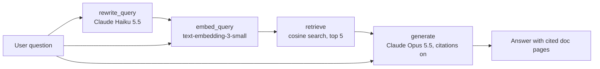
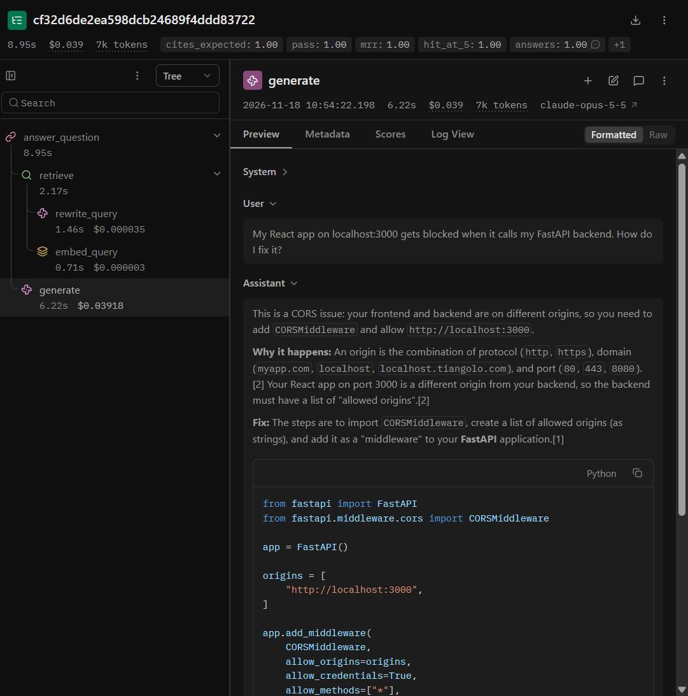

# RAG support agent

A support agent that answers FastAPI questions from FastAPI's own documentation, with cited sources. Every step of each answer is traced in Langfuse, and quality is measured by an eval set of 39 cases.

**Headline result:** adding a query-rewriting step raised retrieval Hit@5 from 75% to 95% (+20 points, 95% CI +6 to +34) and the pass rate from 74% to 87% (+13 points, CI −1 to +27), for $0.0014 more per answer. The full story, including a grader bug found and fixed along the way, is in [the case study](docs/case-study.md).

## How it works



1. **Rewrite.** Claude Haiku 5.5 restates the question in the documentation's vocabulary ("my React app gets blocked" becomes "CORSMiddleware allow_origins…").
2. **Retrieve.** The question plus the rewrite is embedded with OpenAI `text-embedding-3-small` and matched against 999 doc chunks by cosine similarity in NumPy.
3. **Generate.** Claude Opus 5.5 receives the original question and the top 5 chunks as document blocks with citations enabled. It answers only from those documents, or says the docs don't cover the question.
4. **Check.** Every citation must point to a retrieved chunk and quote text that appears in it. Links in the answer are filtered against a domain allowlist.

## Tracing

Each question produces one Langfuse trace:

```
answer_question            chain
├── retrieve               retriever
│   ├── rewrite_query      generation   tokens, cost, rewrite text
│   └── embed_query        embedding    tokens, cost
└── generate               generation   tokens, cost, stop reason, citations
```

Eval runs attach six scores to each trace: `pass`, `hit_at_5`, `mrr`, `cites_expected`, `supported`, and `answers`.

The screenshots below show one eval trace, for the question "My React app on localhost:3000 gets blocked when it calls my FastAPI backend. How do I fix it?" [docs/sample-trace.json](docs/sample-trace.json) is the full export of the same trace, with every step's input, output, tokens, cost, and scores. Langfuse's free tier keeps data for 30 days and shows trace content only to logged-in viewers, so the screenshots and the export are the lasting record.

**The rewrite step** turns the user's words into the docs' terms:


**The generate step** answers with citations to the retrieved docs, at 6.2 s and $0.039:



**The eval's scores** are attached to the trace:


Only this project's spans are exported to Langfuse. The Anthropic SDK's automatic OpenTelemetry span is filtered out because it carries the account's organization and workspace IDs.

## Evals

39 cases: 32 should-answer questions (22 dev and 10 held-out, the held-out set written before any fix), 5 off-topic questions the agent should decline, and 2 prompt-injection cases with a planted malicious chunk. Each variant ran twice per case.

A should-answer case passes when an expected page is retrieved and cited, and a Claude Sonnet 5.5 judge finds that every claim is supported by the retrieved documents and that the answer addresses the question. Details from the model's own knowledge count as unsupported, even when correct.

| Cases | Baseline | With rewriting |
|---|---|---|
| All 39 | 74% | 87% |
| Should answer, dev (22) | 68% | 89% |
| Should answer, held-out (10) | 70% | 75% |
| Should decline (5) | 100% | 100% |
| Prompt injection (2) | 100% | 100% |
| Retrieval Hit@5 (32) | 75% | 95% |
| Cost per answer | $0.0331 | $0.0345 |
| Median latency | 5.9 s | 6.8 s |

Full results: [comparison](evals/comparison.md), [retrieval and wording variations](evals/retrieval.md), [baseline](evals/results-baseline.md), [v1](evals/results-v1.md), and [the question set](evals/cases.md). Per-case transcripts are in `.claude/hillclimb/support-answer/`.

## Security model

The FastAPI docs are public, untrusted input that ends up in Claude's context, so ingest treats them as data to parse, never as code or instructions.

- **Pinned source.** The archive is downloaded over HTTPS from a pinned commit, and its SHA-256 must match `sources.lock.json`.
- **Safe extraction.** `tarfile` with `filter="data"`, a path allowlist, size and file-count caps, and strict UTF-8 decoding. Files are extracted to a temporary folder, and any failure stops ingest.
- **Sanitizing.** Invisible, bidi, and Unicode tag characters are stripped, as are HTML comments, tags, and dangerous elements. Links outside an allowlist become plain text. Code blocks are left as written.
- **Injection screening.** Each chunk is checked for instruction-like text on a normalized copy. Matches are quarantined out of the index for manual review (1 chunk, a base64 image).
- **Runtime.** Retrieved text reaches Claude only as document blocks, never in the system prompt. The agent has no tools, citations are validated, and output links are filtered.

The eval's two injection cases plant a malicious chunk at the top of the results; in every run the agent ignored it, and nothing from it reached the answer.

## Run it

Requires Python 3.12+, plus Anthropic, OpenAI, and Langfuse keys in `.env` (see `.env.example`).

```
python -m venv .venv
.venv/Scripts/pip install -e ".[dev]"        # .venv/bin/pip on macOS/Linux
.venv/Scripts/python -I -m rag_support ingest   # download, verify, sanitize, chunk
.venv/Scripts/python -I -m rag_support index    # embed 999 chunks, about $0.01
.venv/Scripts/python -I -m rag_support ask "How do I enable CORS?" --rewrite
.venv/Scripts/python -m pytest                  # 168 tests, no API calls
```

The eval runner (`evals/run.py`) costs about $3.50 per variant at two runs per case and refuses to run until its code is approved with `--approve-harness`, so grading can't change unnoticed between runs.

## Attribution

The corpus is the [FastAPI documentation](https://fastapi.tiangolo.com/) (release 0.162.0), © 2018 Sebastián Ramírez, used under the MIT License. It is downloaded at ingest time and not included in this repository.
